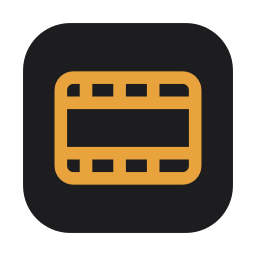

# minilab

<p align="center">
  
</p>

**minilab** is a cross-platform app for scanning, developing and exporting film, a roll at a
time. Whether you scan on a flatbed, photograph your negatives with a camera, or already have
finished scans from a lab, minilab handles frame detection, inversion, colour correction and batch
export.

It supports colour negatives, black and white negatives and slides, on macOS, Linux and Windows.

Written in **Zig 0.17** with a **Dear ImGui** interface. For how it works inside, see
[docs/design.md](docs/design.md).

---

## Features

- **Raw scanning:** linear 16-bit scans straight from your scanner. The Mac download comes with
  SANE's drivers. On Windows, minilab uses your scanner's TWAIN driver.
- **Frame detection:** finds the frames on a scanner preview, a strip scan or a camera shot.
- **One workflow:** scanning, inversion, colour correction and batch export in one app.
- **Datasheet corrections:** the film's datasheet curves open up crushed shadows and keep them
  neutral.
- **Film looks:** Frontier lab emulation, 85 film looks from three free collections, and your own
  `.cube` LUTs (3D or 1D).
- **Fitted looks:** a look that matches your lab, made from a few frames scanned by both.
- **Metadata:** camera, lens, film stock, date, copyright, star ratings and fields of your own,
  written into the exports as EXIF and XMP.
- **Command line:** import, scan and develop from the terminal as well as in the app.

---

## Installation

Download the archive for your platform from the [latest release](../../releases/latest). There
are builds for Windows, macOS and Linux, on x86-64 and Arm, with a file of checksums to check your
download against.

### macOS

The macOS builds aren't signed, so run this once in the unpacked folder to let minilab and the
scanner drivers it comes with through:

```bash
xattr -dr com.apple.quarantine .
```

`minilab --version` tells you which version you have.

## Building it yourself

You need Zig 0.17. Then:

```sh
make build      # or: zig build --release=safe
make run        # builds and opens the app
make test       # runs the tests
make check      # formatting, the repository's file checks and the tests, like CI
```

The first build downloads and compiles every library minilab uses (SDL3, Dear ImGui,
libjpeg-turbo, libtiff, LibRaw and Little CMS) and the film look collections. You don't need to
install anything else, except SANE if you want to scan on macOS or Linux. On a Mac you can build
the SANE the releases come with instead: `scripts/build-sane-macos.sh arm64 zig-out/bin/sane`
(or `x86_64` on an Intel Mac) puts it next to the program, where minilab looks for it. It needs
CMake and the Xcode command line tools.

## Using the app

The app has five workspaces, roughly one per step:

- **Rolls** shows each roll as a contact sheet, with its film, its format and how many frames
  you've developed. Click New roll to start one. Drop scans, or a folder of them, on a roll's row
  to add them. The bin on a roll's card moves the whole roll to the Trash, after you confirm, so
  you can still put it back from there. Rolls added from outside the app, say with
  `minilab import`, show up by themselves.

  A roll can also hold finished scans: pictures that are already positives, like a lab's JPEGs or
  a scanner's that inverts by itself. The roll keeps them as the files they are and shows them
  unchanged, with the usual look, saturation and exposure on top if you want them.
- **Scan** shows the scanner's preview with the frames minilab found on it. You can fix any
  frame's box, then queue the frames up and scan them into a roll. For slides in mounts, pick
  Positive and then Mounted.
- **Develop** is where a negative becomes a picture. You see the negative and the positive side
  by side, and you set the film base, density, inversion curve, colour balance, saturation and a
  look. Sync copies some or all of those settings to the roll's other frames. The Loupe (L) shows
  the spot under the cursor at the scan's full resolution, to check focus and grain. You can also
  give a frame 1 to 5 stars or reject it, in the bar under the picture or with Lightroom's keys:
  0 to 5 for stars, X to reject, U to take the reject back.
- **Export** saves TIFF or JPEG files in sRGB, Display P3, Adobe RGB or ProPhoto RGB, with the
  roll's metadata in them, at full size or with the long edge cut down to a size you pick. A star
  filter picks the frames by rating, and rejected frames start out unticked. You can also fix the
  roll's camera, lens, date, copyright and notes there, and add metadata fields of your own.
- **Looks** lists the looks you can develop with, and lets you make your own (see below).

Picking a film stock in Develop does more than label the roll. Film doesn't respond to light in a
straight line in the shadows: the darkest tones get squeezed together on the negative. When
minilab has the stock's datasheet, it uses the datasheet's curves to undo that for each colour
layer, so the shadows open up instead of going muddy. If you only want the stock as a label,
untick Datasheet corrections.

`minilab open --shortcuts` lists the keyboard shortcuts. Where Lightroom has a shortcut for the
same thing, minilab uses the same key.

## Looks

A look is a colour style that goes on top of what you set in Develop. You pick one from Develop's
Look menu. Apart from Neutral, every look is a LUT (a lookup table that maps each colour to a new
colour) applied on top of Neutral.

- **Neutral:** just the inversion as Develop sets it, with nothing added.
- **Frontier emulation:** the colour of a Fujifilm Frontier lab scanner. Tones, greys and
  brightness stay the same as Neutral. Greens lean a little toward teal, and skin and skies get a
  little richer.
- **Film looks:** 85 film emulations from three free collections, each in its own menu:
  GlassMeter (30 colour negative, slide and B&W films), t3mujinpack (51) and Street Monochrome (4
  B&W looks). The Looks workspace shows who made each collection and its licence.
- **Imported LUTs:** any .cube LUT (3D or 1D, any size) made for sRGB or Rec. 709 input. Import one
  from the Look menu or the Looks workspace, and minilab copies it into the library's `Looks`
  folder.
- **Fitted looks:** your own looks, made in the Looks workspace. You give it pairs of scans of the
  same negatives, one from minilab and one from a lab, and minilab works out a look that makes
  ours match theirs.

## Command line

- `minilab open` opens the app, on a library, roll and workspace of your choice.
- `minilab import` adds scans, or folders of them, to a roll, and makes the roll if it's new.
- `minilab looks` lists the looks.
- `minilab develop` and `minilab develop-roll` develop scans outside the library.
- `minilab detect` lists the frames it finds on a strip scan.
- `minilab scan` makes one scan, and `minilab scan --list` lists the scanners.

`minilab --help` lists every command with its options, and every command takes `--verbose`.
`--look` takes a look name from `minilab looks`, like `glassmeter:kodak-portra-400`, or the path
to a .cube file. `import`'s `--move` moves finished scans (JPEGs) into the roll instead of copying
them. Raw scans are always converted, so their originals stay put.

## Scanning

minilab only looks for scanner drivers when you open Scan, so everything else works without them.

**On a Mac** the download comes with the drivers, so there's nothing to install. They're SANE, a
free collection of drivers for most scanners, in the `sane` folder next to the program. Plug the
scanner in, open Scan, and it's in the list. You don't need the scanner's own Mac software,
and you can leave it installed. Just don't have it open while minilab scans, since only one
program can use the scanner at a time.

If you've installed SANE yourself, from Homebrew or MacPorts, minilab still uses the drivers it
comes with first, and picks up any extra drivers you've added to yours. If the drivers that come
with minilab can't load, it uses yours instead, and if there aren't any, the Scan screen shows how
to install SANE from Homebrew, with a button to copy the command.

**On Linux** install your distribution's SANE package (often `sane-utils` or `sane-backends`).

**On Windows** minilab uses your scanner's TWAIN driver, so install that.

A few scanners need a driver that isn't part of SANE. The Epson Perfection
V200 is one of them: it needs Epson's epkowa driver and its plugin, which minilab can't come with.
On a Mac, install them into Homebrew's SANE and minilab finds them.

minilab scans raw: linear 16-bit data, with the scanner doing no inversion or colour correction
of its own. That leaves the film base (the colour of the bare film, orange on most colour
negatives) untouched, so minilab can measure it in the gaps between frames.

For the Epson Perfection V200 that comes from a profile we measured. For any other scanner,
minilab works it out from the driver's own settings: gamma 1.0, colour correction off and the
film type on positive. The box under the scanner's name on the Scan screen says what it managed.
If it got something wrong for your scanner, open **Scanner settings** and pick another value for
any of them. Your changes are saved per scanner, and Reset puts the scanner back on Auto.

## Licence

minilab is under the Mozilla Public License 2.0 (see `LICENSE`). The libraries it builds keep
their own licences, and the build puts a copy of each next to the program. LibRaw is linked under
the LGPL 2.1, so you can relink minilab with your own LibRaw.

The Mac download also carries SANE (under the GPL, mostly with an exception for programs that use
it), libusb (LGPL 2.1) and libjpeg-turbo. Their licences are in its `sane` folder, along with a
README that says where their source is, and each release has the source archives attached.

The film stock presets are our own readings of the film datasheets;
[data/stocks/README.md](data/stocks/README.md) explains how we read them. The film looks come from
GlassMeter by Glass Works and Street Monochrome by Ivan Bogachev, both under CC BY 4.0, and
t3mujinpack by João Almeida, under the MIT licence. The build downloads them and puts their
licences and `CREDITS-looks.txt` next to the program.
